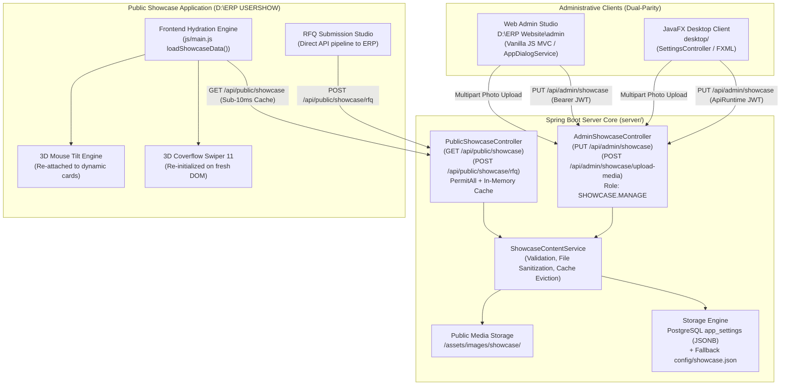
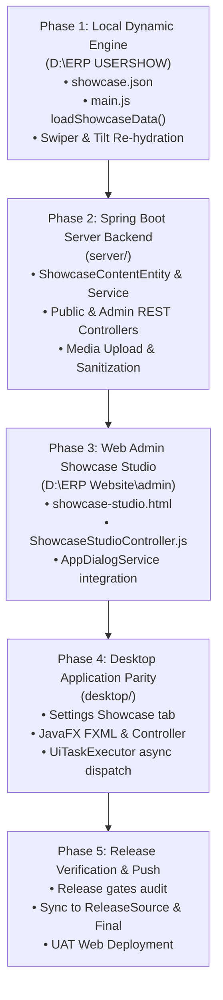

# Jasvi Industries - Dynamic 3D User Showcase Architecture Specification
**Document ID:** `DSE-SPEC-SHOWCASE-DYNAMIC-V1.0`  
**Target Projects:** `D:\ERP USERSHOW`, `server/`, `D:\ERP Website\admin`, `desktop/`  
**Governance Protocols:** `dse-erp-master-protocol.md`, `rules/dse-erp-environment.md`, Ponytail (`.pony-trail`), Cloudflare Security Audit  
**Date:** October 31, 2026  

---

## 1. Executive Summary & Objective

The **Jasvi Industries User Showcase** (`D:\ERP USERSHOW`) is currently styled with Dark Industrial Claymorphism and features high-performance 3D animations (particle constellation canvas, Swiper 11 3D Coverflow carousel, and mouse-tilt physics).

### Core Objective
Transform the showcase from static HTML into a **100% dynamically managed headless system**. An administrator using either:
1. **The Web Admin Portal** (`D:\ERP Website\admin`), or
2. **The JavaFX Desktop Client** (`desktop/`),

can update any text, KPI statistic, machinery workstation slide, technical specifications table, component portfolio item, process step, and factory contact detail—as well as upload high-resolution machinery photos—with **instant live updates** across the website without recompiling code or restarting servers.

---

## 2. End-to-End System Architecture



---

## 3. Unified JSON Data Schema (`showcase.json`)

All showcase content is defined by a clean, strongly-typed JSON schema:

```json
{
  "version": 1,
  "lastModified": "2026-10-31T19:00:00Z",
  "branding": {
    "companyName": "JASVI INDUSTRIES",
    "tagline": "Precision Engineering",
    "badgeText": "Next-Gen Industrial Digital Engineering",
    "portalUrl": "https://erp.jasviindustries.in/"
  },
  "hero": {
    "headline": "Precision Machining. Zero Compromise.",
    "leadParagraph": "Jasvi Industries delivers micron-tolerance 5-axis CNC milling, high-speed turning, and turnkey contract fabrication for global aerospace, EV, and high-tech engineering partners.",
    "primaryCta": { "label": "Instant Blueprint RFQ", "anchor": "#rfq" },
    "secondaryCta": { "label": "Explore 3D Machinery", "anchor": "#showcase-3d" },
    "kpiStats": [
      { "id": "stat-1", "value": "15", "suffix": "+", "label": "Years Industrial Mastery" },
      { "id": "stat-2", "value": "±0.01", "suffix": "mm", "label": "CMM Verified Tolerance" },
      { "id": "stat-3", "value": "10K", "suffix": "+", "label": "Precision Parts Delivered" },
      { "id": "stat-4", "value": "ISO", "suffix": "9001", "label": "Certified Quality System" }
    ]
  },
  "marquee": [
    "ISO 9001:2015 Certified System",
    "5-Axis Simultaneous VMC",
    "±0.005mm Micron Tolerance",
    "CMM 3D Metrology Lab",
    "Aerospace Ti-6Al-4V Grade",
    "100% Full Material Traceability",
    "DFM Blueprint Analysis",
    "Automated Live-Tooling Turning"
  ],
  "machinery": [
    {
      "id": "mach-vmc-5axis",
      "title": "5-Axis VMC Machining",
      "badge": "Simultaneous Multi-Axis",
      "description": "Engineered for impellers, aerospace turbine blades, and compound complex housings in a single clamping.",
      "image": "assets/images/machine_vmc_5axis.jpg",
      "specs": [
        { "key": "Working Area", "value": "1200 x 800 x 600 mm" },
        { "key": "Positional Accuracy", "value": "±0.004 mm" },
        { "key": "Direct Spindle", "value": "15,000 RPM HSK-A63" }
      ],
      "active": true,
      "sortOrder": 1
    },
    {
      "id": "mach-cnc-turning",
      "title": "CNC Precision Turning",
      "badge": "Live-Tooling Lathe",
      "description": "Twin-spindle turning centers with driven tools for mill-turn rotational components and high-precision shafts.",
      "image": "assets/images/machine_cnc_turning.jpg",
      "specs": [
        { "key": "Max Chucking Dia", "value": "Ø 450 mm" },
        { "key": "Bed Length", "value": "Up to 1000 mm" },
        { "key": "Surface Quality", "value": "Ra 0.35 µm" }
      ],
      "active": true,
      "sortOrder": 2
    }
  ],
  "portfolio": {
    "categories": [
      { "key": "all", "label": "All Industries" },
      { "key": "aerospace", "label": "Aerospace" },
      { "key": "automotive", "label": "Automotive & EV" },
      { "key": "energy", "label": "Energy & Hydraulics" }
    ],
    "items": [
      {
        "id": "port-1",
        "category": "aerospace",
        "title": "Titanium Impeller Rotor",
        "description": "Machined from solid Grade 5 Titanium billet using 5-axis continuous milling.",
        "badges": ["Ti-6Al-4V", "±0.008 mm", "CMM Inspected"],
        "active": true
      }
    ]
  },
  "process": [
    { "step": "01", "title": "DFM Feasibility", "description": "CAD model review, toolpath simulation, and material yield optimization within 24 hours." },
    { "step": "02", "title": "CNC Machining", "description": "Multi-axis automated machining with calibrated tooling and real-time spindle monitoring." },
    { "step": "03", "title": "CMM Metrology", "description": "100% dimensional verification against GD&T specs with digital CMM inspection reports." },
    { "step": "04", "title": "Global Delivery", "description": "VCI anti-rust barrier packaging and barcoded shipment with complete material certificates." }
  ],
  "rfqConfig": {
    "materials": [
      { "value": "aluminum", "label": "Aluminium (6061-T6 / 7075-T6)" },
      { "value": "stainless", "label": "Stainless Steel (304 / 316L / 17-4PH)" },
      { "value": "titanium", "label": "Titanium (Grade 2 / Grade 5)" },
      { "value": "brass", "label": "Brass & Copper Alloys" },
      { "value": "mild-steel", "label": "Mild Steel / Tool Steel" },
      { "value": "other", "label": "Other High-Performance Alloy" }
    ],
    "quantities": [
      { "value": "prototype", "label": "Prototype (1 - 10 Units)" },
      { "value": "pilot", "label": "Pilot Batch (10 - 100 Units)" },
      { "value": "production", "label": "Series Production (100 - 5,000 Units)" },
      { "value": "high-volume", "label": "High-Volume Annual Contract (5,000+ Units)" }
    ]
  },
  "contact": {
    "plantAddress": "Plot No. 42, GIDC Industrial Estate, Surat, Gujarat, India.",
    "email": "info@jasviindustries.in",
    "phone": "+91 98765 43210",
    "certification": "ISO 9001:2015 Certified",
    "copyrightYear": 2026
  }
}
```

---

## 4. Backend REST API Design (`server/`)

### 4.1 Endpoints Specification

| Method | Path | Security / Role | Purpose |
| :--- | :--- | :--- | :--- |
| `GET` | `/api/public/showcase` | `permitAll()` | Returns live showcase JSON. Cached in memory with ETag. |
| `POST` | `/api/public/showcase/rfq` | `permitAll()` | Submits a technical RFQ with blueprint attachment. Logs lead in ERP. |
| `GET` | `/api/admin/showcase` | `hasAuthority('SHOWCASE.MANAGE')` or `ADMIN` | Fetches active and draft showcase content for editing. |
| `PUT` | `/api/admin/showcase` | `hasAuthority('SHOWCASE.MANAGE')` or `ADMIN` | Validates and persists updated showcase content. Evicts cache. |
| `POST` | `/api/admin/showcase/upload-media` | `hasAuthority('SHOWCASE.MANAGE')` or `ADMIN` | Secure image uploader for machine workstations and case studies. |

### 4.2 Security & Cloudflare Audit Defenses
Following the installed **Cloudflare Security Audit** skill rules:
1. **Path Traversal Shield:** Uploaded filenames are strictly sanitized via regex:
   ```java
   String cleanFileName = UUID.randomUUID() + "_" + rawName.replaceAll("[^a-zA-Z0-9.-]", "_");
   ```
2. **MIME Whitelist & Magic Byte Verification:** Allowed types strictly restricted to `image/jpeg`, `image/png`, `image/webp`. Executables and SVG scripts rejected.
3. **File Size Enforcement:** Maximum upload size strictly capped at 10MB per image via Spring's `BoundedUpload`.
4. **XSS Prevention on Showcase Frontend:** Text insertions on the public website use `.textContent` (never raw unescaped `innerHTML`).

---

## 5. Web Client Showcase Studio (`D:\ERP Website\admin`)

Adheres strictly to **Section 3.1 of `dse-erp-master-protocol.md`**:
- **Pure Decoupled Vanilla JS MVC:**
  - View: `admin/views/showcase-studio.html`
  - Controller: `admin/js/controllers/ShowcaseStudioController.js`
  - Service: Integrated with `ApiService.js`
- **Zero Raw Alerts:** All notifications, confirmations, and discard prompts use `AppDialogService.confirm()` and `AppDialogService.showToast()`.
- **Tabbed Studio Navigation:**
  ```
  [ 🌟 Hero & KPIs ] [ 🏭 3D Machinery Slides ] [ 💼 Portfolio ] [ ⚙️ Roadmap & RFQ ] [ 📍 Plant Contact ]
  ```
- **Machine Slide Editor Component:**
  - Card list with visual thumbnail preview.
  - Drag-to-reorder slides.
  - Dynamic key-value row builder for technical specifications (`+ Add Spec Row`).
  - Dropzone for rapid machine image replacement.
- **Dual Action Dock:**
  - `Preview Draft`: Opens local showcase in a modal / new tab with staged changes.
  - `Publish to Live Website`: Atomically saves configuration via `PUT /api/admin/showcase`.

---

## 6. Desktop Application Parity (`desktop/`)

Adheres strictly to **Section 3.3 and 7-Point Inspection of `dse-erp-master-protocol.md`**:
- **Module Location:** `desktop/src/main/java/org/example/controller/SettingsController.java` (or dedicated `ShowcaseManagementController.java`).
- **FXML View:** `desktop/src/main/resources/fxml/pages/settings_showcase.fxml`.
- **Non-blocking Concurrency (`UiTaskExecutor`):** Image uploads and API publishing execute off the JavaFX Application Thread, displaying a clean spinner without freezing the desktop window.
- **Components:**
  - `ListView<MachinerySlideDto>` with custom `ListCell` rendering thumbnail, title, and active toggle.
  - `TableView<SpecEntry>` for key-value machine specs with inline cell editing.
  - Native `FileChooser` for selecting machine photography with automatic resizing/compression.
  - Synchronous fallback: when running standalone with embedded server, updates database directly; when connected over network, dispatches via `ApiRuntime`.

---

## 7. Phased Implementation Roadmap



### Phase Breakdown

1. **Phase 1: Local Dynamic Engine (`D:\ERP USERSHOW`)**
   - Create `data/showcase.json` with baseline factory and machine data.
   - Refactor `js/main.js`: extract static HTML cards into template renderers (`renderHero()`, `renderStats()`, `renderMachinery()`, `renderPortfolio()`, `renderProcess()`, `renderContact()`).
   - Add graceful fetch pipeline: `fetch('/api/public/showcase').catch(() => fetch('data/showcase.json'))`.
   - Re-initialize Swiper 11 Coverflow and 3D card tilt listeners after DOM insertion.
   - Test locally via `Preview Showcase.bat`.

2. **Phase 2: Spring Boot Server Backend (`server/`)**
   - Implement `ShowcaseContentEntity` and `ShowcaseContentRepository` in `server/.../persistence/`.
   - Implement `ShowcaseService` with memory caching (`ConcurrentHashMap`) and atomic JSON serialization.
   - Configure `SecurityConfig.java` to whitelist `GET /api/public/showcase` and `POST /api/public/showcase/rfq`.
   - Add `AdminShowcaseController` with `PUT /api/admin/showcase` and `POST /api/admin/showcase/upload-media`.

3. **Phase 3: Web Admin Showcase Studio (`D:\ERP Website\admin`)**
   - Create `admin/views/showcase-studio.html` adhering to standard DSE dark admin styling.
   - Implement `admin/js/controllers/ShowcaseStudioController.js`.
   - Wire into `admin/index.html` navigation under `Website & Showcase`.
   - Test full save and photo upload cycle.

4. **Phase 4: Desktop Application Parity (`desktop/`)**
   - Add `settings_showcase.fxml` in `desktop/src/main/resources/fxml/pages/`.
   - Implement JavaFX controller with `UiTaskExecutor` background dispatch.
   - Verify zero-latency rendering and proper modal dialog lifecycle (`OwnedDialog`).

5. **Phase 5: Release Verification & Deployment**
   - Run release gates: `python scripts/audit-release-gates.py`.
   - Compile: `.\mvnw.cmd test-compile -DskipTests`.
   - Synchronize across `D:\JavaProject\DSE-ERP-Final` and `D:\GitHub\ReleaseSource`.
   - Deploy web showcase assets to `D:\GitHub\DSE-ERP-Enterprise` for live UAT hosting.

---

## 8. Governance, Gates & Clean Root Protocol

In strict compliance with **`RULE[user_global]`** and **`dse-erp-master-protocol.md`**:
- **Clean Root Protocol:** ZERO `CHANGELOG-*.md` files allowed in root. All documentation and release notes stay in their designated directories.
- **Protected Database Rule:** NEVER execute experimental SQL against production port `55432` (`D:\DSE Production`). All table alterations use backward-compatible Flyway migrations.
- **IntelliJ Sync Rule:** Only synchronize changes to `D:\JavaProject\DSE-ERP-Final` after explicit user confirmation that the implementation is ready for local testing.

---
*Authored and governed under DSE-ERP Master Protocol Standards.*
